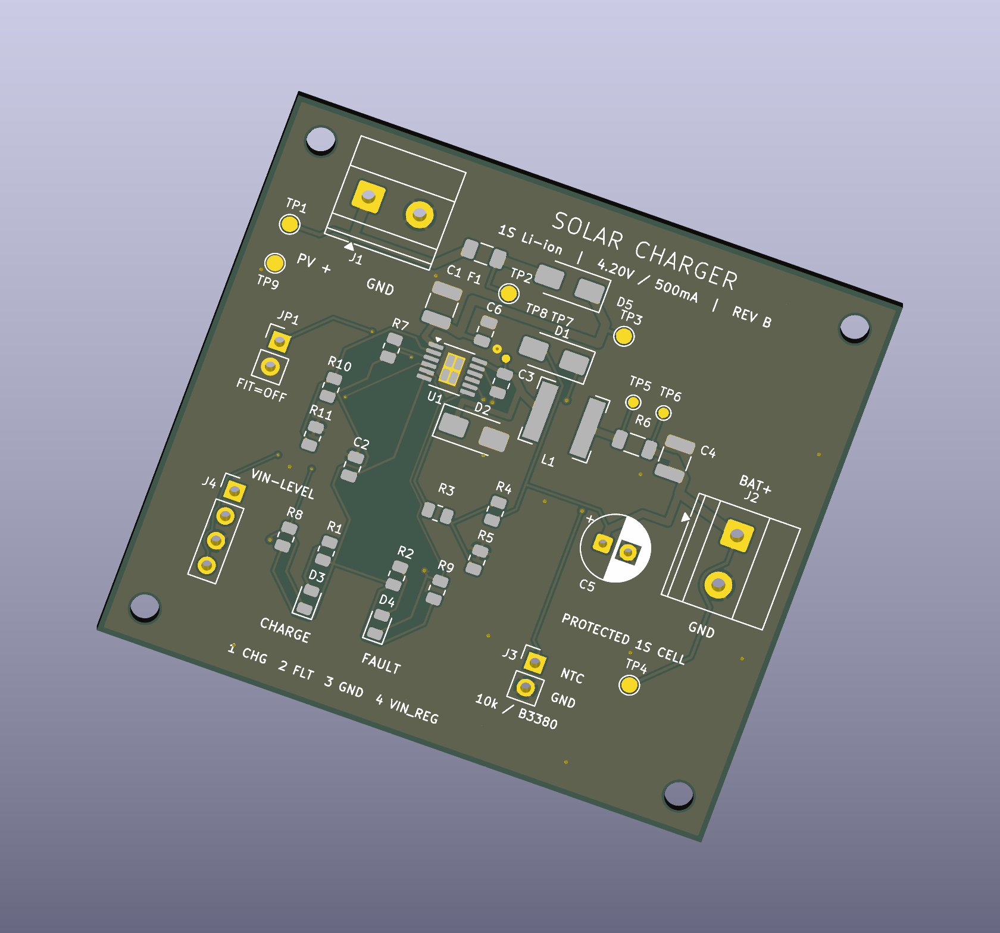

# PCB-desgning-

Solar battery charge controller designed in KiCad, with green charging and red fault LEDs.

The editable project, local libraries, populated 3D assembly, drawings, BOM, and prototype fabrication files are in **[solar-charger-led-revB/](solar-charger-led-revB/)**.

[Final project report with individual contributions (PDF)](reports/Solar_Charger_RevB_Final_Report.pdf)

## Latest revision: B

Revision B adds an onboard solar-input fuse and series reverse-polarity Schottky diode, nine test points, a shutdown jumper, and corrected VIN_REG labeling. The 4.2 V / 500 mA charging settings and 60 × 55 mm board size are retained.

- [Rev B changes](solar-charger-led-revB/CHANGELOG.md)
- [Staged test plan and expected-versus-measured worksheet](solar-charger-led-revB/TEST_PLAN.md)
- [Earlier Rev A, retained for comparison](solar-charger-led-revA/)

The series diode adds a forward-voltage drop; the fixed input-regulation target remains 17.874 V on the protected charger side. The open/disconnected-NTC limitation remains: monitoring is disabled if its sensor is disconnected. Input protection does not cover reversed battery connections or input overvoltage.

## Open the project

Download or clone this repository, then open [`Solar_Charger_LED_RevB.kicad_pro`](solar-charger-led-revB/Solar_Charger_LED_RevB.kicad_pro) in **KiCad 9 or newer**. Keep the project folder and its local libraries together.

- [Circuit schematic (PDF)](solar-charger-led-revB/previews/Schematic.pdf)
- [Populated PCB preview](solar-charger-led-revB/previews/PCB_3D.png)
- [3D viewing instructions and assembly STEP](solar-charger-led-revB/3D/README.md) — bundled component models; opens in KiCad or FreeCAD
- [Bill of materials](solar-charger-led-revB/BOM.csv)
- [Design details, connector pinouts, and first-power-up instructions](solar-charger-led-revB/README.md)
- [Validation results](solar-charger-led-revB/validation/RESULTS.json)
- [Sources and attribution](solar-charger-led-revB/ATTRIBUTION.md)

## Design target

- One protected 3.7 V nominal lithium-ion 18650 cell, **4.2 V CC/CV** chemistry.
- **500 mA** nominal maximum charging current; the cell must permit this rate.
- Nominal **12 V solar panel**, approximately 18 V at maximum power, **cold open-circuit voltage no greater than 25 V**.
- **LT3652EMSE#PBF in MSOP-12**, with an external 10 kohm / B3380 K battery-temperature sensor.
- Two-layer, 60 × 55 mm PCB with charge/fault LEDs and labeled connectors.

## Validation and prototype status

The revision passes KiCad ERC and PCB DRC with zero violations, zero unconnected items, and zero schematic/PCB mismatches. The exported netlist passes 48 electrical-topology and critical-value checks, and the PCB passes 20 additional probe-layout and check-configuration checks.

The populated 3D model supports presentation and visual inspection of placement, orientation, and connector access. It uses representative component bodies; see the [model notes](solar-charger-led-revB/3D/README.md) before relying on dimensions. This addition changes no circuit routing or fabrication geometry and does not demonstrate charging or LED operation.

**This is an unbuilt engineering prototype.** It has not been fabricated, physically tested, or electrically simulated. Complete the documented bench checks before connecting a lithium-ion cell. J4 status outputs are pulled up to the solar input voltage and must not be connected directly to microcontroller GPIOs.

The design builds on the user-supplied [upstream project](https://github.com/Hirusha785/solar-battery-charge-controller-pcb), whose README credits Fernando S.M.H.G. Attribution and KiCad library license notices are included in the project folder.
